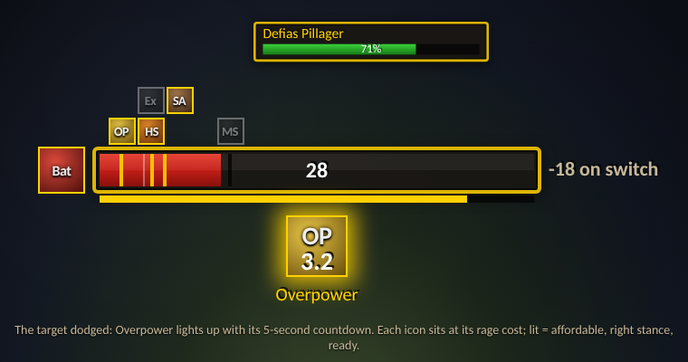
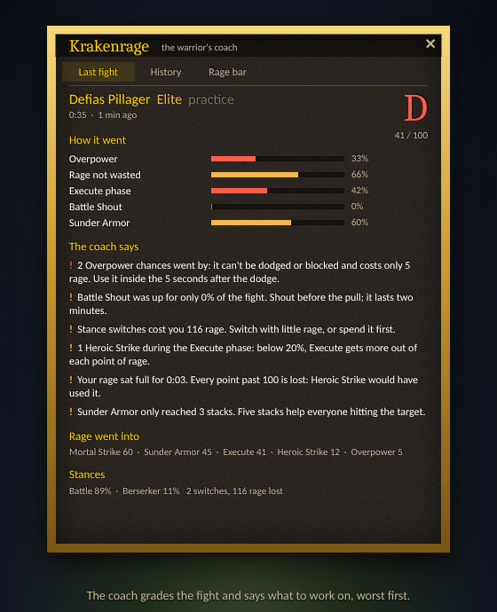

# Krakenrage

A rage bar and a coach for the **warrior** in **World of Warcraft: Forever**, in the game's own style (gold border, dark stone, the fantasy font), like KrakenChat.



## The rage bar

- **Your rage, with a tick for each ability.** Every ability you use gets a tick at its real rage cost, read from the game, so talents like Improved Heroic Strike move it. The ability's icon sits above the tick and lights up when you can press it: enough rage, the right stance, off cooldown. Abilities that cost the same share a tick (Execute and Sunder Armor at 15, Overpower and Revenge at 5).
- **Pick your ticks.** The defaults are Heroic Strike, Execute, Mortal Strike, Bloodthirst, Shield Slam, Whirlwind, Sunder Armor, Revenge and Overpower, whichever of them you know. Tick or untick any ability in the coach window under "Rage bar". The choice is saved per character, since an Arms warrior and a tank want different ticks.
- **Heroic Strike queued** glows on its icon.
- **Stance and what a switch costs.** Your stance sits left of the bar. Right of it, "-25 on switch" shows the rage a stance switch would cost you now. A faint line on the bar marks what you keep: the addon learns that from your first switch (Tactical Mastery keeps 5 per point).
- **Alerts for the moments that matter.** Big icons under the bar for **Overpower** (with the 5-second countdown after a dodge), **Revenge** (after you dodge, parry or block) and **Execute** (target below 20%). If you're in the wrong stance, the icon is grey and names the stance it needs. That's your cue to stance-dance.
- **Swing timer (experimental).** A thin bar under the rage shows your next main-hand swing. It turns amber with Heroic Strike queued, and red when that Heroic Strike would leave you too little rage for Mortal Strike, Bloodthirst or Shield Slam while it's ready.
- **Out of your way.** Out of combat with no rage, the bar dims. It lets clicks through while locked. `/kr lock` unlocks it for dragging, `/kr scale` resizes it.

## The coach

After every fight of six seconds or more, the coach grades it (S, A, B, C, D) and says what went well and what didn't, the most important first:

- **Overpower**: chances used, chances that went by, chances with too little rage, and dodges while you were out of Battle Stance.
- **Revenge**: chances used and unused.
- **Rage wasted**: how long your rage sat at 100, and what would have used it (Heroic Strike, or Cleave with more than one foe).
- **Execute phase**: how long the target was below 20%, your Executes, and Heroic Strikes that should have been Executes.
- **Heroic Strike timing**: Heroic Strikes that left you short of rage for your big ability while it was ready.
- **Battle Shout**: uptime during the fight.
- **Stance switches**: how many, and the rage they cost.
- **Sunder Armor**: how long until five stacks, and whether it fell off.
- **Where the rage went**: rage spent per ability.

A short note pops up above the bar after each fight of ten seconds or more ("2 tips from the coach. Click to read."). Click it to open the details.

**History**: the last 200 fights per character. The window lists the newest 12; click one to read it again. **Trends** compare your last 10 fights with the 10 before: grade, Overpower and Revenge use, rage wasted per minute, Battle Shout uptime, each marked better or worse.



`/kr demo` fills the coach with twelve sample fights (a warrior who gets better fight by fight), good for a first look and for screenshots. `/kr demo` again removes them.

## Practice mode: be a warrior without one

`/kr practice` works on **any character**, not just warriors. It turns you into a pretend level 30 Arms warrior and plays a fight against a pretend foe every 45 seconds, so the whole addon comes alive: rage filling and draining, the ticks lighting up, Charge, Battle Shout, Sunder Armor, the dodge that lights Overpower, Heroic Strike queued on the swing timer, a stance switch with its rage cost, the Execute phase, and the coach grading each fight with the note above the bar.

Every other fight is sloppy on purpose: an Overpower let go, no Battle Shout, rage sitting at 100, a stance switch with a full bar, a Heroic Strike in the Execute phase. That way the coach has something to say, and the clean fights after it show up as "better" in the trends.

The fights go through the real code: practice only stands in for the game (rage, stance, cooldowns, the target, buffs) and hands the bar, the swing timer and the coach the same events a real fight would. Practice fights are kept, marked "practice". `/kr practice` again stops it, and so does any real fight.

## How it sees the fight

**Forever has no combat log for addons**, and parts of the game's data can arrive as "secret values" an addon can't compute with. So Krakenrage works from what the game does hand out, and stays quiet when it can't know:

- **Overpower chances**: your target dodging (solo; in a group the dodge could have been someone else's) and the game lighting Overpower up (in Battle Stance). A chance only counts as missed if, at some point inside the 5 seconds, you were in Battle Stance, it was off cooldown and you had the rage.
- **Revenge chances**: you dodging, parrying or blocking, which the game reports reliably, and Revenge lighting up.
- **Execute phase**: the target's health, or Execute lighting up when health is hidden.
- **Swings**: Heroic Strike and Cleave report when they land. A swing that hits gives rage, so a rage gain you didn't get from being hit, from Bloodrage or from Charge is taken as your weapon. Solo, the target's dodges, parries and misses count too. Between those, the timer counts on with your attack speed. That's why it's marked experimental: misses in a group and dual-wield off-hand hits can make it jitter.
- **Secret values**: every value is checked before use. If your rage itself comes back as a secret, the bar still fills (status bars may show secrets), but the number and the "can I afford it" lighting fall back to the game's own "usable" check.

## Commands

| Command | What it does |
| --- | --- |
| `/kr` | Open or close the coach window |
| `/kr lock` | Unlock the rage bar to move it, lock it again |
| `/kr scale 1.2` | Make the bar bigger or smaller (0.5 to 2) |
| `/kr reset` | Put the bar back in the middle of the screen |
| `/kr swing` | Show or hide the swing timer |
| `/kr procs` | Turn the Overpower, Revenge and Execute alerts on or off |
| `/kr stance` | Show or hide the stance icon and the switch cost |
| `/kr fade` | Dim the bar out of combat, or always show it |
| `/kr toasts` | Turn the note after each fight on or off |
| `/kr minimap` | Show or hide the minimap button |
| `/kr demo` | Add or remove sample fights |
| `/kr practice` | Start or stop practice mode (pretend warrior fights, on any character) |
| `/kr clear` | Forget this character's fights |
| `/kr debug` | Print what the coach sees (chances, swings, stance costs) to chat |

The minimap button opens the coach. Right-click it to lock or unlock the bar.

## Install

Copy the `Krakenrage` folder into the game's `Interface\AddOns` folder, then log in with a warrior. On other classes the addon stays asleep until you type `/kr practice`.

## Screenshots

`assets/screenshots/` holds pictures of every part: the bar with Overpower lit, Heroic Strike queued, rage capped and the Execute alert; the note after a fight; and the coach's three pages. They're drawn from a real practice run: `tools/screenshots/shots.js` plays practice mode headless, records what the addon shows (rage, ticks and which are lit, the swing timer, alerts, the coach's grades, tips and trends) and draws it in the layout of `Hud.lua` and `UI.lua`. The game's fonts, textures and spell icons aren't available outside the game, so the icons are tinted stand-ins with the ability's short name. In the game you see the real spell icons.

```
cd tests && npm install && cd ..
node tools/screenshots/shots.js
```

## Icon

`assets/krakenrage-icon.svg` is the source: the Krakenfriends kraken raising a sword, with a red glow of rage on dark stone and a gold rim. `Media/icon.tga` (64x64) is the game texture made from it, for the addon list. `Media/minimap.tga` comes from `assets/krakenrage-minimap.svg`, the same without the rim and zoomed in, for the minimap button. `assets/krakenrage-icon-512.png` is the large version, for CurseForge.

## Tests

A headless test suite plays fights through a mocked game API (on [fengari](https://github.com/fengari-lua/fengari), Lua in JavaScript):

```
cd tests
npm install
npm test
```

It covers a non-warrior staying asleep, practice mode on a mage (two full fights, the sloppy one graded worse, a real fight ending it), ticks at talented costs, Overpower used, missed and starved, Revenge, the Execute phase, rage capped, stance-switch costs and learning what you keep, Sunder Armor, the swing timer, Heroic Strike starving your big ability, grades and tips, secret values, the window, demo fights and trends, and the commands.

## Known limits

- **Untested in the live game.** Built against the Forever API as Krakenfriends uses it and verified headless. Expect tuning once it meets real fights: which values are secret in combat, how the swing timer holds up, the thresholds for tips.
- **Overpower in groups** is only seen through the game lighting it up, so dodges while you're out of Battle Stance aren't counted there.
- **The swing timer** follows the main hand only.
- **Retail** isn't supported: warriors there work differently, and Midnight's combat restrictions rule most of this out.
